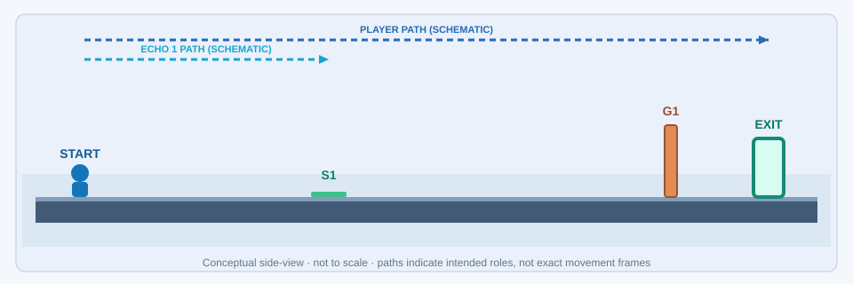
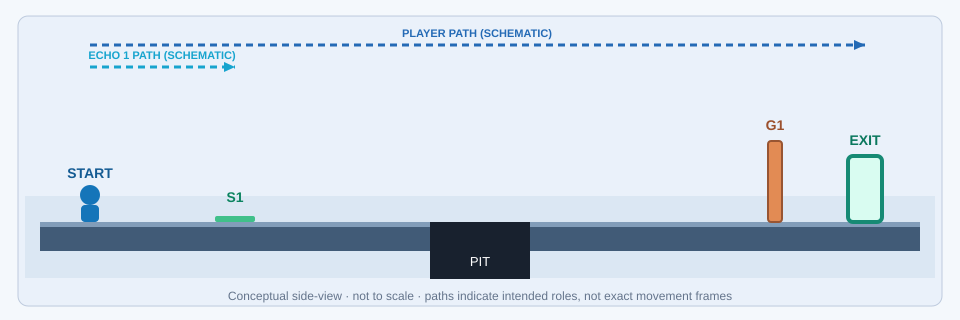
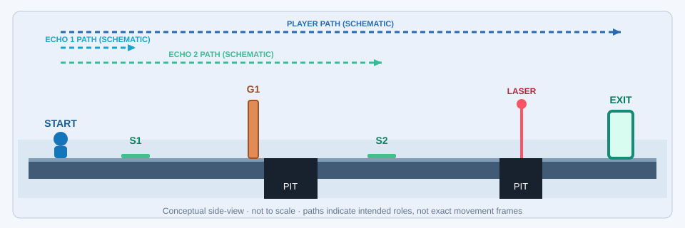
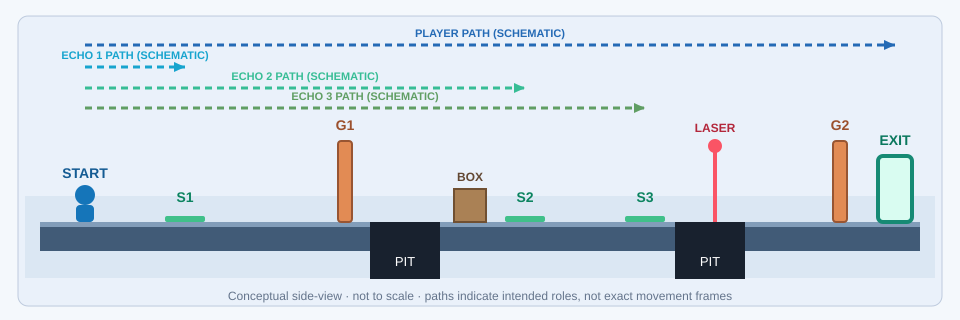
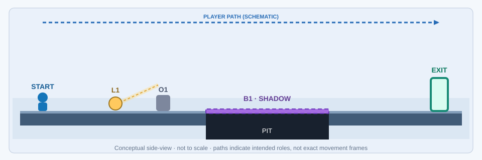
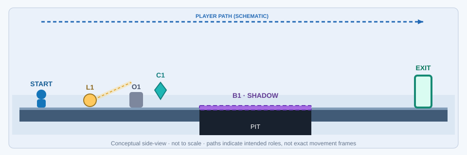
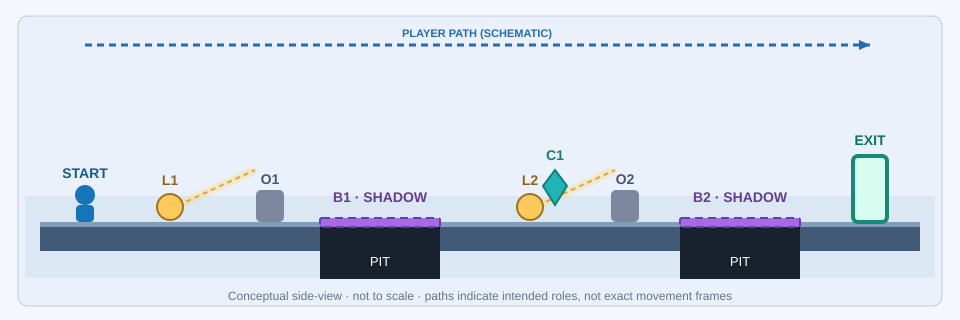
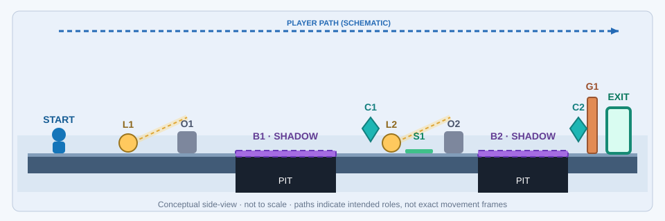

# מטלה 3 – חלק א׳: תכנון רמות

**מחבר:** אחמד בשיר  
**משחקים:** Echo Shift ו־Shadow Switch  
**מנוע:** Unity 2D  

> המסמך הוא תכנון מפורט לרמות מוצעות. התרשימים סכמטיים (מבט צד) ולא משקפים מידות מדויקות. יש לכייל מרחקי קפיצה, מהירות דמות וצריכת אנרגיה בניסוי משחק.

## עקרונות התקדמות בקושי

| משחק | הדרכה | קלה | בינונית | קשה |
|---|---|---|---|---|
| Echo Shift | הד יחיד ומתג | הד אחד, שער ובור | שני הדים, שער ולייזר | שלושה הדים, קופסה ושני שערים |
| Shadow Switch | פנס אחד וגשר ללא מגבלת אנרגיה | אנרגיה מוגבלת וגביש | שני פנסים ושני גשרים | שני פנסים, שני גשרים ומתג |

## הנחות תכנון ומונחים

- **Echo Shift:** כל מחזור הקלטה נמשך כ־10 שניות; עד שלושה הדים פעילים, בהתאם לקונספט המקורי. ההד משחזר את הפעולות המוקלטות. מתגי לחץ נשארים פעילים כל עוד דמות/הד עומדים עליהם. נדרשת הימנעות מהתנגשות בהדים ובלייזרים.
- **Echo Shift – תיקון משחקיות מוצע:** כדי למנוע כישלון בלתי נמנע בתחילת כל מחזור, אזור ההתחלה יהיה אזור בטוח מהתנגשות שחקן–הד עד לעזיבתו, או שתינתן חסינות קצרה בתחילת שחזור. מחוץ לאזור זה נשמר כלל ההתנגשות המקורי. ההחלטה תמומש ותיבדק ב־Unity.
- **Shadow Switch:** רק צל של עצם ייעודי על אזור הקרנה ייעודי יוצר גשר מוצק; הגשר קיים רק כשהתאורה המתאימה פעילה. מרמה 2 ומעלה תאורה צורכת אנרגיה; גבישים ממלאים אותה.
- **סימון תרשימים:** START – תחילת השחקן; EXIT – יציאה; S – מתג; G – שער; L – פנס; O – עצם מטיל צל; B – גשר צל; C – גביש; PIT – בור; LASER – לייזר. חצים מקווקווים מתארים תפקיד או מסלול כללי, לא תנועות מדודות בזמן.

## המשחק: Echo Shift

### רמה 1: הד ראשון – הדרכה (Tutorial)

**זמן משחק משוער:** 2–3 דקות. **מספר הדים מרבי:** 1.

**מטרת הרמה:** ללמוד תנועה, קפיצה, הקלטת פעולות ומעבר דרך דלת שנפתחת באמצעות הד.

**מבנה המפה:** חדר מעבדה ישר ללא בורות או לייזרים. אזור התחלה משמאל, משטח לחיצה ירוק באמצע החדר, שער סגור לקראת הסוף ודלת יציאה מימין. שעון ההקלטה מוצג בבירור.

**רכיבים:** דמות שחקן; משטח לחיצה אחד (S1); שער אחד (G1); אזור יציאה; תצוגת ציר זמן של 10 שניות; כפתור איפוס.

**מה השחקן עושה – פתרון אפשרי:**

1. הודעת הדרכה מציגה תנועה ב־A/D, קפיצה ב־Space והפעלה/אינטראקציה ב־E.
2. במחזור הראשון השחקן מתקדם למשטח S1 ונשאר עליו עד לסיום הקלטה של 10 שניות.
3. בתחילת המחזור הבא ההד חוזר על המסלול ודורך על S1; השער G1 נפתח כל עוד המשטח לחוץ.
4. השחקן מתכנן מסלול חדש, נמנע מההד, עובר דרך G1 ומגיע ליציאה.

**מכשולים ואתגרים:** להבין שההד חוזר על הפעולות הקודמות ולא פועל עצמאית; להישאר על המשטח מספיק זמן כדי לאפשר מעבר.

**כיצד הקושי עולה:** הדרכה ללא לחץ זמן מלבד מחזור ההקלטה; חידה עם מתג יחיד ונתיב ברור. הרמזים חזותיים ומפורשים.

**תנאי הצלחה וכישלון:** ניצחון: הגעה ליציאה כאשר השער פתוח. כישלון/ניסיון חוזר: התנגשות בהד מחוץ לאזור ההתחלה או מסלול הקלטה שאינו מפעיל את המתג; ניתן לאפס ב־R.

### רמה 2: שומר הדלת – קלה

**זמן משחק משוער:** 3–4 דקות. **מספר הדים מרבי:** 1.

**מטרת הרמה:** להשתמש בהד כדי לשמור שער פתוח בזמן שהשחקן חוצה בור קטן וקופץ אל היציאה.

**מבנה המפה:** התחלה משמאל; S1 סמוך להתחלה; בור קטן באמצע שניתן לקפוץ מעליו; G1 מעבר לבור; דלת יציאה בהמשך. השער נראה כאשר נמצאים ליד S1.

**רכיבים:** משטח לחיצה S1, שער G1, בור אחד ברוחב שניתן לעבור בקפיצה, דלת יציאה, הד אחד ומונה הקלטה.

**מה השחקן עושה – פתרון אפשרי:**

1. במחזור הראשון עומדים על S1 עד שההקלטה מסתיימת.
2. במחזור השני משאירים להד ללחוץ על S1, מתזמנים את התנועה כך שלא נפגשים בו, וקופצים מעל הבור.
3. מגיעים אל G1 בזמן שההד ממשיך ללחוץ על המתג, חוצים את השער ויוצאים.

**מכשולים ואתגרים:** תזמון בסיסי בין ההד לשחקן ושילוב הקפיצה עם חלון הזמן שבו השער פתוח.

**כיצד הקושי עולה:** פחות טקסט עזרה, נוסף בור פיזי, וצריך לשלב שתי פעולות שנלמדו: שימור מתג וניווט.

**תנאי הצלחה וכישלון:** ניצחון: הגעה ליציאה דרך שער פתוח. כישלון: נפילה לבור, מגע אסור בהד או נעילת שער עקב עזיבת S1 מוקדם מדי.

### רמה 3: שני תפקידים – בינונית

**זמן משחק משוער:** 4–6 דקות. **מספר הדים מרבי:** 2.

**מטרת הרמה:** לתכנן שני מחזורי הקלטה נפרדים: הד אחד פותח שער, והד שני מנטרל לייזר כדי שהשחקן יעבור.

**מבנה המפה:** חדר ארוך המחולק לשלושה אזורים. משטח S1 משמאל פותח שער G1; מעבר צר מוביל למשטח S2 במרכז; S2 משבית לייזר פעיל ליד הבור השני. היציאה נמצאת מעבר לאזור הלייזר.

**רכיבים:** שני משטחי לחיצה S1/S2, שער G1, לייזר אדום, שני בורות קטנים/מעברים, דלת יציאה ועד שני הדים.

**מה השחקן עושה – פתרון אפשרי:**

1. מחזור 1: מקליטים תנועה והישארות על S1 כדי לשמור על G1 פתוח.
2. מחזור 2: בזמן שהד הראשון פותח את G1, עוברים אל S2 ומקליטים שהייה על המתג כדי להשבית את הלייזר.
3. מחזור 3: שני ההדים מבצעים את תפקידיהם; השחקן חוצה את G1, קופץ מעל הבורות ועובר את אזור הלייזר אל היציאה.

**מכשולים ואתגרים:** לזכור מה כל הד יעשה בכל שנייה; למנוע הצטלבות מסוכנת בין מסלולי ההדים לבין המסלול הנוכחי.

**כיצד הקושי עולה:** החידה כבר אינה נפתרת על ידי הד אחד; יש שני תנאים מתמשכים ושני סוגי מכשולים. אין פתרון באמצעות ריצה ישירה.

**תנאי הצלחה וכישלון:** ניצחון: מעבר בשער ובאזור הלייזר כאשר שני המתגים פעילים. כישלון: נפילה, מגע בלייזר, התנגשות בהד או סגירת אחד המנגנונים.

### רמה 4: סנכרון מלא – קשה

**זמן משחק משוער:** 6–9 דקות. **מספר הדים מרבי:** 3.

**מטרת הרמה:** לתאם שלושה הדים עם מתגים, קופסה ולייזר, ולבצע מעבר אחרון ללא התנגשות בגרסאות העבר.

**מבנה המפה:** מעבדה הכוללת מעבר ראשון נעול (G1), ארגז שנדרש להזיז כדי להגיע למתג S2, בור מרכזי, אזור לייזר ושער יציאה סופי (G2). שלושה אזורי עבודה נפרדים מורידים התנגשות בלתי הוגנת.

**רכיבים:** עד שלושה הדים; משטחי S1/S2/S3; שערים G1/G2; ארגז שניתן להזיז ב־E; לייזר אדום; שני בורות; יציאה.

**מה השחקן עושה – פתרון אפשרי:**

1. מחזור 1: ההד הראשון נשאר על S1 ופותח את G1.
2. מחזור 2: עוברים דרך G1, דוחפים ארגז אל נקודת גישה בטוחה ומתמקמים על S2; פעולה זו מאפשרת ביטול לייזר.
3. מחזור 3: בעזרת שני ההדים הראשונים מגיעים ל־S3 ומקליטים עמידה עליו, הפותחת את G2.
4. מחזור 4: שלושת ההדים פועלים במקביל; השחקן בוחר תזמון שאינו מצטלב עם המסלולים, עובר את הלייזר הכבוי ואת G2 ומגיע ליציאה.

**מכשולים ואתגרים:** שלושה מסלולים מוקלטים בו־זמנית, תזמון הדוק, תכנון סדר הפעולות ותמרון קופסה. פתרון בטעות עלול ליצור מצב לא פתיר שמחייב R.

**כיצד הקושי עולה:** מגיעים למגבלת שלושת ההדים שהוגדרה ברעיון המשחק; משלבים את כל המכניקות בלי להוסיף חוק שרירותי חדש.

**תנאי הצלחה וכישלון:** ניצחון: שלושת התנאים מתקיימים בו־זמנית והדמות מגיעה ליציאה. כישלון: לייזר פעיל, נפילה, התנגשות בהד או שער שנסגר.

## המשחק: Shadow Switch

### רמה 1: הגשר הראשון – הדרכה (Tutorial)

**זמן משחק משוער:** 2–3 דקות. **מספר הדים:** לא רלוונטי.

**מטרת הרמה:** ללמוד כיצד הפעלת פנס, כיוונו אל עצם מסומן ויצירת צל הופכים בור בלתי עביר לגשר.

**מבנה המפה:** חדר קטן; התחלה משמאל; פנס L1 מול עצם O1; בור רחב מכדי לקפוץ מעליו; אזור הטלה מסומן; יציאה מימין.

**רכיבים:** פנס קבוע L1, עצם מטיל צל O1, אזור הקרנה, גשר צל B1, בור ודלת יציאה. אנרגיה אינה מוגבלת בשלב זה.

**מה השחקן עושה – פתרון אפשרי:**

1. השחקן מתקרב ל־L1 ומדליק אותו ב־E.
2. גוררים את כיוון הפנס בעכבר עד שהאלומה פוגעת ב־O1 ומטילה צל על אזור B1.
3. B1 מקבל מתאר סגול והופך למשטח מוצק; חוצים אותו אל היציאה.

**מכשולים ואתגרים:** להבין מדוע רק צל שמוטל על אזור ייעודי נעשה מוצק, ולזהות את המשוב החזותי.

**כיצד הקושי עולה:** אין מגבלת אנרגיה ואין צורך בהחלפת פנסים; ההצלחה מבודדת את המכניקה המרכזית של המשחק.

**תנאי הצלחה וכישלון:** ניצחון: הגעה ליציאה לאחר יצירת הגשר. כישלון: נפילה לבור אם הגשר לא פעיל; R מאפס.

### רמה 2: האור שאוזל – קלה

**זמן משחק משוער:** 3–4 דקות. **מספר הדים:** לא רלוונטי.

**מטרת הרמה:** ללמוד לחסוך באנרגיית פנס, לאסוף גביש ולהפעיל גשר רק כאשר מוכנים לחצות.

**מבנה המפה:** חדר עם פנס L1, עצם O1, גביש אנרגיה C1 לפני הבור, גשר B1 קצר ודלת יציאה בצד השני. מד האנרגיה מוצג לכל אורך השלב.

**רכיבים:** פנס אחד עם אנרגיה התחלתית מוגבלת (ערך מוצע: 60%), גביש C1 חד־פעמי, עצם O1, בור B1, יציאה.

**מה השחקן עושה – פתרון אפשרי:**

1. מתקדמים אל C1 ואוספים אותו במגע כדי לקבל תוספת אנרגיה.
2. מכוונים את הפנס כאשר הוא כבוי כדי לא לבזבז אנרגיה, ואז מדליקים אותו ב־E.
3. ממתינים להופעת המתאר הסגול של B1, חוצים במהירות ומגיעים ליציאה.

**מכשולים ואתגרים:** תכנון סדר פעולה: איסוף אנרגיה, כיוון התאורה ורק אז הפעלתה. היעלמות הגשר במקרה של התרוקנות מחייבת תזמון.

**כיצד הקושי עולה:** אותה מכניקת גשר כמו בהדרכה, אך כעת מתווספים משאב מתכלה וגביש מוגבל בלי ריבוי פנסים.

**תנאי הצלחה וכישלון:** ניצחון: חציית הבור לפני שהאנרגיה נגמרת. כישלון: נפילה או התרוקנות האנרגיה ללא דרך להשלים; R מאפס.

### רמה 3: שתי זוויות – בינונית

**זמן משחק משוער:** 4–6 דקות. **מספר הדים:** לא רלוונטי.

**מטרת הרמה:** לחצות שני בורות בעזרת שני פנסים בעלי זוויות שונות, תוך שימוש באי בטוח ובגביש אנרגיה בין המעברים.

**מבנה המפה:** חדר ארוך, בור ראשון משמאל ובור שני מימין. בין הבורות אי בטוח עם גביש C1. L1 יוצר את B1 ואילו L2, הממוקם באי הבטוח, מאפשר ליצור את B2 בזווית שונה.

**רכיבים:** שני פנסים L1/L2, שני עצמים O1/O2, שני אזורי גשר B1/B2, גביש אחד, מד אנרגיה ושני בורות.

**מה השחקן עושה – פתרון אפשרי:**

1. מכוונים את L1 לעבר O1, מפעילים ויוצרים את B1 כדי להגיע לאי הבטוח.
2. על האי אוספים את C1, מכבים את L1 כדי לחסוך באנרגיה ומכוונים את L2 לעבר O2.
3. מפעילים את L2 ליצירת B2, חוצים את הבור השני ומגיעים ליציאה.

**מכשולים ואתגרים:** לנהל אנרגיה בין שתי הפעלות, להבחין שהגשר הראשון נעלם כאשר משנים זווית, ולהתמקם על קרקע בטוחה לפני שינוי.

**כיצד הקושי עולה:** לראשונה נדרשת החלפה בין שני מקורות אור בזוויות שונות וחשיבה על סדר ההפעלות; כל מעבר מותנה בגשר מתאים.

**תנאי הצלחה וכישלון:** ניצחון: שתי חציות תקינות ויציאה. כישלון: שינוי תאורה בזמן עמידה על גשר, נפילה או מחסור באנרגיה.

### רמה 4: מעבדת הצל הכפול – קשה

**זמן משחק משוער:** 6–9 דקות. **מספר הדים:** לא רלוונטי.

**מטרת הרמה:** לשלב שני פנסים, שני גשרי צל, ניהול אנרגיה ומתג לפתיחת דלת היציאה.

**מבנה המפה:** חדר מחולק לשלושה אזורים. L1 יוצר B1 מעל הבור הראשון; במרכז יש גביש C1 ומתג S1; L2 יוצר B2 מעל הבור השני; שער G1 נמצא לפני היציאה.

**רכיבים:** שני פנסים L1/L2, שני עצמים O1/O2, שני בורות וגשרים B1/B2, שני גבישי אנרגיה (C1/C2), מתג אינטראקציה S1, שער G1 ודלת יציאה.

**מה השחקן עושה – פתרון אפשרי:**

1. מתחילים עם אנרגיה מוגבלת; מכוונים ומפעילים את L1 רק כאשר מוכנים לחצות את B1.
2. מגיעים לאזור המרכזי, אוספים את C1 ומפעילים את S1 ב־E כדי לשחרר את הנעילה של G1.
3. מכבים את L1; מכוונים את L2 לעבר O2, יוצרים את B2 וחוצים את הבור השני.
4. אוספים את C2 במידת הצורך, עוברים בשער שכבר נפתח ומגיעים ליציאה.

**מכשולים ואתגרים:** ניהול שני מקורות אור, סדר פעולות נכון, שתי חציות ותנאי נוסף של שער נעול. אנרגיה יכולה להיגמר אם מפעילים את שני הפנסים ללא צורך.

**כיצד הקושי עולה:** השלב משלב את כלל המכניקות שנלמדו: אור, צל, שינוי כיוון, אנרגיה, גבישים, מתגים ויציאה.

**תנאי הצלחה וכישלון:** ניצחון: שני הבורות נחצו והמתג שחרר את G1. כישלון: נפילה, אנרגיה שאזלה לפני חצייה או אי־פתיחת השער.

## בדיקת תכנון לפני מימוש

- לבדוק שכל בור שנועד לקפיצה ישירה נמצא בטווח הקפיצה בפועל; ובורות עם גשר צל מחייבים גשר כדי לחצות.
- לבדוק במבחן משחק שלא ניתן להיתקע בלי אפשרות איפוס, ושכל שער מובן חזותית.
- לבדוק שההדים מחזיקים מתגים בזמן הנדרש ושלא נוצרת התנגשות שחקן–הד שאי אפשר להימנע ממנה.
- לבדוק שקצב צריכת האנרגיה וערכי הגבישים מאפשרים פתרון אך מתגמלים כיבוי פנסים.

## בחירת רמה למימוש בחלק ב׳

**המלצה:** Shadow Switch – רמה 2 (״האור שאוזל״), משום שהיא מממשת חידה מלאה עם פנס, גשר, אנרגיה וגביש, אך קלה יותר לתכנות בהשוואה לשחזור מדויק של שלושה הדים ב־Echo Shift. אפשר למלא את דרישות חלק ב׳ באמצעות Spawn של גבישי Prefab, התנגשות של השחקן עם הגשר/הגביש/הבור/היציאה, מעבר לסצנת ניצחון או Game Over ושמירת מספר גבישים/מצב משחק בין סצנות.

**חשוב:** בחלק ב׳ יש גם לבנות WebGL, לפרסם ב־itch.io, לוודא שהמשחק עובד דרך דפדפן טלפון, ובנוסף להכין ולהדגים קובץ התקנה ל־Android או לצלם סרטון ריצה על נייד – לפי נוסח המרצה. נדרש גם שילוב של דגם שנוצר באמצעות בינה מלאכותית בתוך מערכת Prefab/Spawn.
